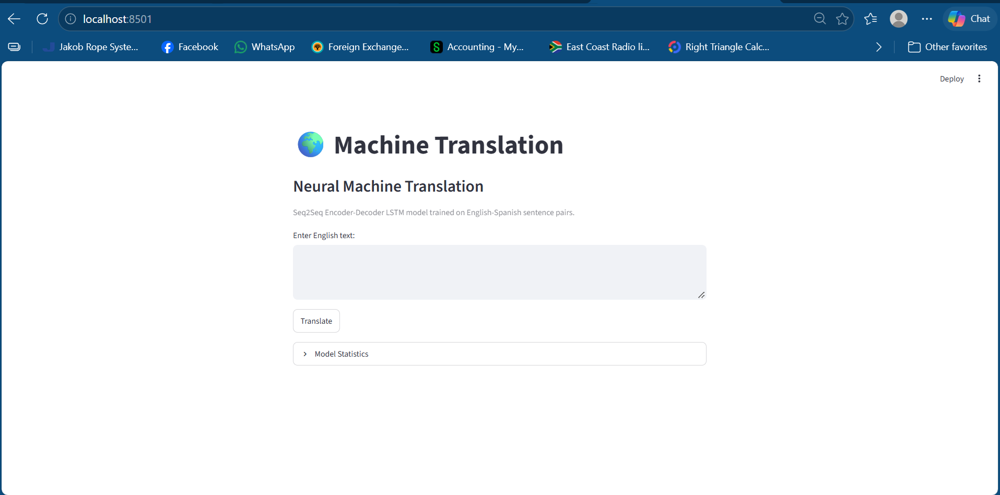
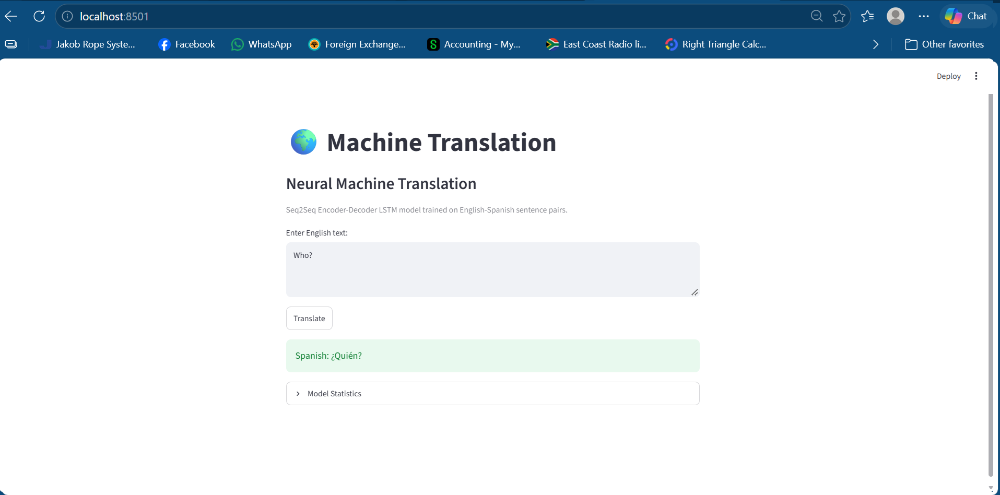
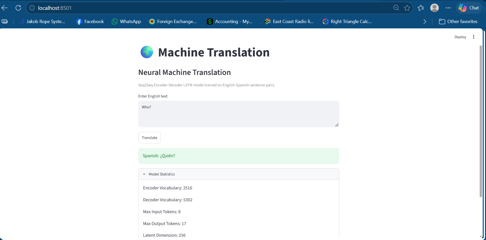

# 🌍 Machine Translation with Seq2Seq Neural Networks

A Neural Machine Translation (NMT) system that translates English to Spanish using TensorFlow, Keras, and a Seq2Seq Encoder-Decoder architecture built with LSTM neural networks.

Originally developed as part of the Codecademy Machine Translation project, this application has been extended into a complete machine learning portfolio project with:

- Interactive command-line translator
- Streamlit web application
- Statistics dashboard
- Unknown vocabulary detection
- Custom sentence translation
- Early stopping
- Modern Keras model persistence (`.keras`)
- Improved preprocessing and tokenization

---

# 🚀 Features

## Neural Machine Translation

Translate English sentences into Spanish using:

- Seq2Seq architecture
- Encoder-Decoder design
- LSTM neural networks
- Teacher forcing
- TensorFlow / Keras

Example:

```text
Input:
Who?

Output:
¿Quién?
```

---

## Interactive Command-Line Application

Launch the translator directly from the terminal:

```bash
python src/translate.py
```

Features:

```text
1 - Translate custom text
2 - Test dataset examples
3 - Show model statistics
4 - Exit
```

---

## 🌐 Streamlit Web Application

The project includes a web-based interface powered by Streamlit.

Run:

```bash
streamlit run streamlit_app.py
```

The application launches in your browser and allows users to:

- Enter English text
- Generate Spanish translations
- View model statistics
- Interact with the translator without using a terminal

---

# 📸 Application Screenshots

## Home Page



---

## Translation Example



---

## Model Statistics



---

# 📂 Project Structure

```text
machine-translation/
│
├── assets/
│   ├── home-page.png
│   ├── translation-example.png
│   └── model-statistics.png
│
├── data/
│   └── spa.txt
│
├── models/
│   └── training_model.keras
│
├── src/
│   ├── preprocessing.py
│   ├── train.py
│   ├── translate.py
│   └── utils.py
│
├── tests/
│
├── streamlit_app.py
│
├── README.md
├── LICENSE
├── requirements.txt
└── .gitignore
```

---

# 🧠 Model Architecture

## Encoder

```text
Input Sequence
      ↓
LSTM (256 units)
      ↓
Hidden State
Cell State
```

## Decoder

```text
Start Token
      ↓
LSTM (256 units)
      ↓
Dense Softmax Layer
      ↓
Predicted Output Token
```

### Total Parameters

```text
9,894,582
```

### Latent Dimension

```python
latent_dim = 256
```

---

# 📊 Dataset

Source:

ManyThings.org Language Dataset

Language Pair:

```text
English → Spanish
```

Training Data Used:

```text
10,000 sentence pairs
```

Vocabulary Learned:

```text
Encoder Vocabulary : 2516 words
Decoder Vocabulary : 5302 words
```

---

# ⚙️ Training Configuration

```python
latent_dim = 256
batch_size = 50
epochs = 100
```

Training uses:

```python
EarlyStopping(
    monitor="val_loss",
    patience=5,
    restore_best_weights=True
)
```

This automatically stops training once validation performance stops improving.

---

# 📈 Model Statistics Dashboard

The application provides real-time model information.

Example:

```text
Encoder vocabulary : 2516
Decoder vocabulary : 5302

Maximum input tokens : 8
Maximum output tokens : 17

Latent dimension : 256

Model size : 75.52 MB
```

---

# 🔍 Unknown Vocabulary Detection

Custom translation mode detects words that were not present in the training dataset.

Example:

```text
Input:
My name is Wayne

Warning:
'Wayne' not found in training vocabulary
```

This helps explain translation limitations.

---

# 🛠 Technologies Used

- Python 3
- TensorFlow
- Keras
- NumPy
- Streamlit
- Natural Language Processing (NLP)
- Seq2Seq Neural Networks
- LSTM Networks
- Machine Learning
- Deep Learning

---

# 💻 Installation

Clone the repository:

```bash
git clone https://github.com/YOUR_USERNAME/machine-translation.git
```

Navigate into the project:

```bash
cd machine-translation
```

Create a virtual environment:

```bash
python -m venv venv
```

Activate:

### Windows

```bash
venv\Scripts\activate
```

Install dependencies:

```bash
pip install -r requirements.txt
```

---

# ▶️ Usage

## Train the Model

```bash
python src/train.py
```

Output:

```text
models/training_model.keras
```

---

## Run CLI Translator

```bash
python src/translate.py
```

---

## Run Web Application

```bash
streamlit run streamlit_app.py
```

---

# 🧪 Example Results

### Input

```text
Who?
```

### Translation

```text
¿Quién?
```

---

### Input

```text
Run!
```

### Translation

```text
¡Órale!
```

---

### Input

```text
How are you?
```

### Translation

```text
¿Estabas aquí?
```

---

# 🎯 Learning Outcomes

This project demonstrates:

- Neural Machine Translation
- Encoder-Decoder Architectures
- Seq2Seq Models
- LSTM Networks
- Deep Learning Workflows
- Model Persistence
- TensorFlow / Keras Development
- NLP Tokenization
- Streamlit Application Development
- Git & GitHub Project Management

---

# 🔮 Future Enhancements

Potential future improvements:

- Word Embeddings
- Attention Mechanisms
- Transformer Architecture
- Translation Confidence Scores
- BLEU Score Evaluation
- Larger Training Datasets
- Multiple Language Support
- Docker Deployment
- Cloud Hosting

---

# 🏷 Topics

Machine Learning • Deep Learning • NLP • Natural Language Processing • Machine Translation • Neural Machine Translation • Seq2Seq • Encoder Decoder • LSTM • TensorFlow • Keras • Streamlit • Python • Artificial Intelligence

---

# 📄 License

This project is licensed under the MIT License.

See the LICENSE file for details.

Codecademy Machine Translation project and expanded into a standalone machine learning portfolio project featuring a Streamlit web application, custom translation interface, statistics dashboard, and modern Keras workflow.